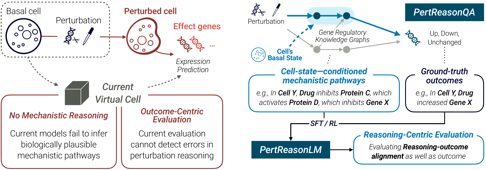
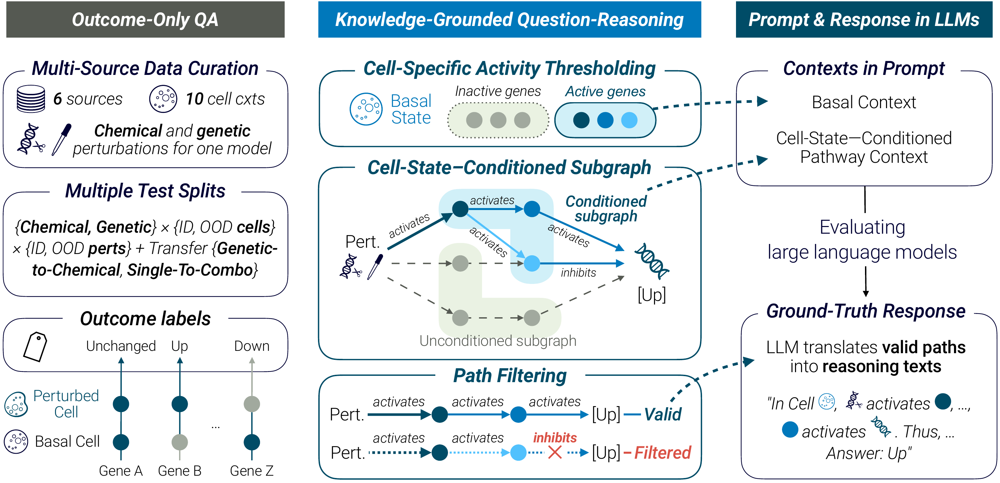

# PertReason: A Knowledge-Grounded Benchmark and Framework for Cell-State-Conditioned Mechanistic Reasoning of Perturbation Effects

<p align="left">
  <a href="https://arxiv.org/abs/2607.18777">Paper</a> &nbsp;·&nbsp;
  <a href="https://huggingface.co/datasets/yiminggao618/PertReasonQA">Dataset</a> &nbsp;·&nbsp;
  <a href="#code">Code</a> &nbsp;·&nbsp;
  <a href="#citation">Citation</a>
</p>

<p align="center">
  
</p>

Evaluating machine learning in scientific domains requires separating correct predictions from correct reasons under realistic distribution shifts. We introduce PertReason, a knowledge-grounded approach to evaluating and improving cell-state–conditioned reasoning about perturbation effects. Our framework comprises PertReasonQA, a benchmark that provides evaluation and supervision, and PertReasonLM, a reference large language model that demonstrates how such supervision supports reasoning-centric training. PertReasonQA tests whether models can generate mechanistically faithful explanations while remaining robust to complex shifts, such as new cells, unseen perturbations, cross-modal or combinatorial extrapolations. PertReasonQA combines single-cell genetic and chemical perturbation data across multiple cellular contexts with knowledge graphs, and dynamically conditions pathways on cell-specific basal states to avoid generic memorization. Evaluations of state-of-the-art models reveal systematic gaps between outcome prediction and mechanistic reasoning. As a reference probe of the benchmark, PertReasonLM is trained through supervised fine-tuning and reinforcement learning using mechanistic supervision from PertReasonQA. PertReasonLM improves predictive accuracy and reduces answer–reason disagreement by grounding rationales in context-specific pathways. Together, we provide a diagnostic framework for exposing and mitigating failures in faithful reasoning in data-rich scientific systems. We release our datasets to support further research at https://dongkwan-kim.github.io/PertReason/.

## Dataset

<p align="center">
  
</p>

PertReasonQA contains question-answer records derived from single-cell genetic and chemical perturbation data across multiple cellular contexts. It includes outcome-only training and validation data, mechanistic reasoning records with reference and candidate pathways, and evaluation prompts with or without cell-conditioned pathways. Evaluation covers unseen cells and perturbations, genetic-to-chemical transfer, and combinatorial perturbations.

The dataset files are hosted on Hugging Face: [yiminggao618/PertReasonQA](https://huggingface.co/datasets/yiminggao618/PertReasonQA).

## Code

```bash
python -m pip install scikit-learn
python src/model_prompt.py  # default: --preset cell_cond_path
python src/model_prompt.py --preset no_path
python src/out_answer_eval_compute.py
python src/out_triplet_eval_metrics.py
```

| File | Purpose |
| --- | --- |
| `src/model_prompt.py` | Generate three-way QA prompts from JSONL records, with or without retrieved pathways. |
| `src/out_answer_eval_compute.py` | Match predictions by ID and compute Accuracy, Balanced Accuracy, micro/weighted F1, and per-class F1. |
| `src/out_triplet_eval_metrics.py` | Match predictions by ID and evaluate causal triplets using precision, recall, F1, connectivity, and GOSim when GO annotations are available. |
| `data_aux/c5.go.bp.v2023.2.Hs.symbols.gmt` | MSigDB Human C5 GO Biological Process gene sets (v2023.2), automatically loaded for GOSim evaluation. |

## Citation

```bibtex
@inproceedings{kim2026pertreason,
  title={PertReason: A Knowledge-Grounded Benchmark and Framework for Cell-State-Conditioned Mechanistic Reasoning of Perturbation Effects},
  author={Kim, Dongkwan and Gao, Yiming and Yang, Yining and Shen, Yang},
  booktitle={The Fortieth Annual Conference on Neural Information Processing Systems Evaluations and Datasets Track},
  year={2026},
  url={https://openreview.net/forum?id=nDBq0FPB7Y}
}
```
